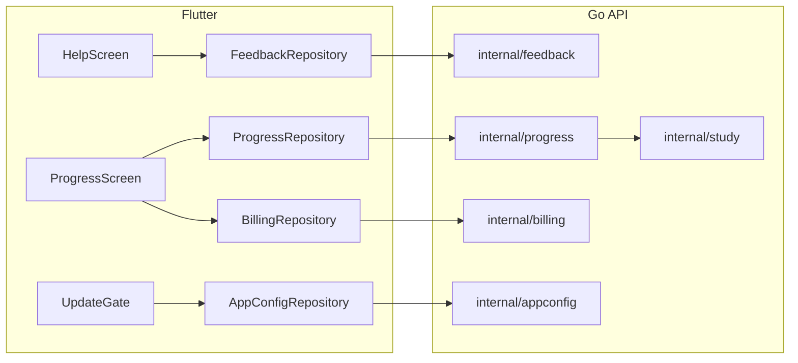

# Plan: Feedback, My Progress API, app update policy

Depends on approved `tasks/spec-feedback-progress-app-updates.md`.

## Components

## Order (dependencies)

1. **Feedback backend**: table, handler, limits, OpenAPI (nothing depends on it).
2. **Feedback client**: replaces Help “soon” snackbars.
3. **Progress backend**: read-only service over study + profile; Pro check via billing service or plan lookup.
4. **Progress client**: VM loads `/me/progress` when `isPro`; skeleton UI for weekly block.
5. **App config backend**: env-driven handler (no DB).
6. **App config client**: fetch on startup; force blocks router; soft shows banner on shell.
7. **Integration tests**: feedback submit; progress unlock; config force (inject low minBuild in test server or mock).

## Risks

| Risk | Mitigation |
|------|------------|
| Progress aggregates slow | Single SQL query or cached rollup; timeout; show profile-only fallback |
| RC Pro but plan free | Keep client `isPro` OR logic; server Pro check uses same billing service as `/me/plan` |
| Force update locks out testers | `ACADEME_MIN_BUILD=0` in dev; document test builds |
| Feedback spam | Account + IP rate limits |

## Verification checkpoints

- After step 2: manual submit on emulator against local server.
- After step 4: `integration_test` progress + purchase.
- After step 6: bump env minBuild, confirm block on emulator.
